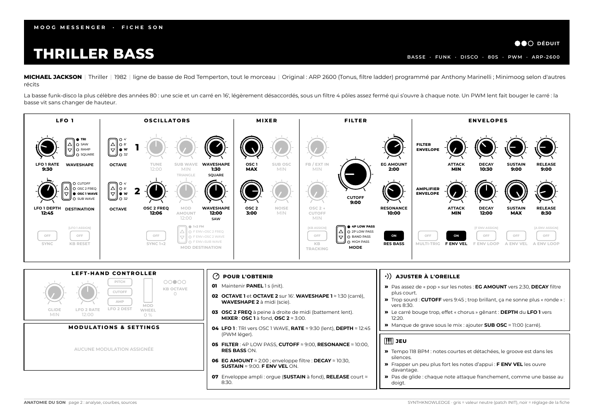
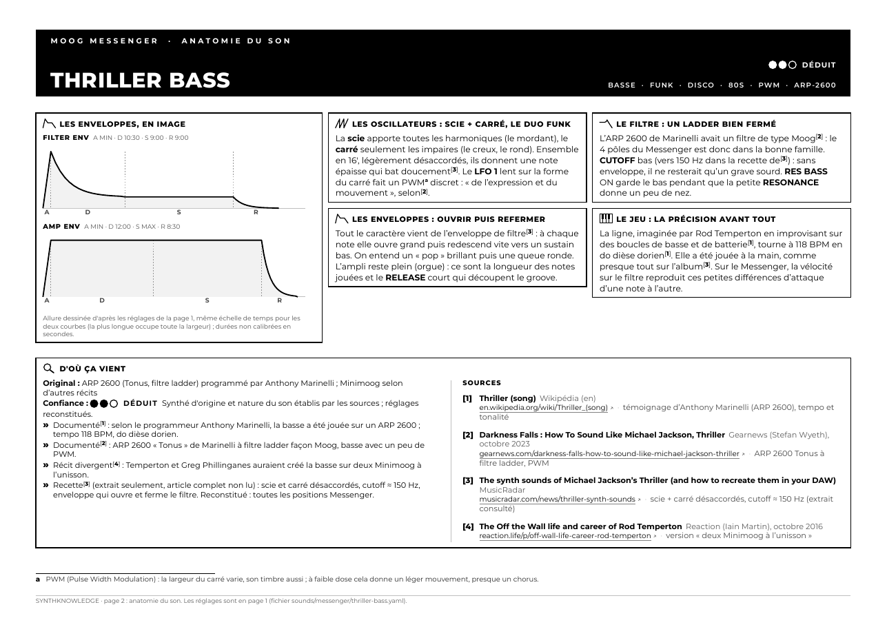
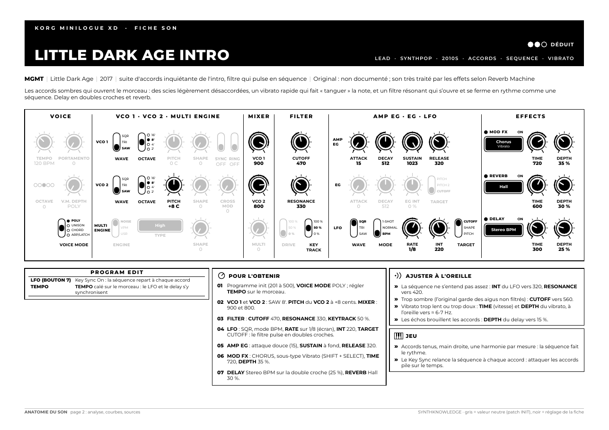

<h1 align="center">🎛️ Synther</h1>

<p align="center">
  <b>Refaire les sons des morceaux qu'on aime, sur ses propres synthés.</b><br>
  Des fiches A4 visuelles pour le <b>Moog Messenger</b> et le <b>Korg minilogue XD</b> :<br>
  la façade dessinée potard par potard, les étapes, et l'explication du son.
</p>

<p align="center">
  
  
  
  
</p>

<p align="center">
<!-- compteurs:start -->
📄 <b>20 fiches</b> · 🎤 14 groupes · 🎹 12 pour le Moog Messenger · 8 pour le Korg minilogue XD
<!-- compteurs:end -->
</p>

<table>
  <tr>
    <td width="50%"></td>
    <td width="50%"></td>
  </tr>
  <tr>
    <td align="center"><sub><b>Page 1 : les réglages.</b> Toute la façade, noir = à régler, gris = position neutre.</sub></td>
    <td align="center"><sub><b>Page 2 : l'anatomie du son.</b> Pourquoi ça sonne comme ça, et d'où viennent les infos.</sub></td>
  </tr>
</table>

## Les fiches

> [!TIP]
> Cliquer sur **PDF** pour ouvrir la fiche : lisible sur téléphone, à imprimer en A4 paysage.

<!-- fiches:start -->
| Groupe | Morceau | Année | Type de son | Synthé | Son d'origine | Confiance | Fiche |
|---|---|:-:|---|---|---|---|:-:|
| **The Black Eyed Peas** | I Gotta Feeling | 2009 | Pluck (intro) | Korg minilogue XD | Non documenté | ⚫⚪⚪ approximation | [PDF](sheets/minilogue-xd/%5BThe%20Black%20Eyed%20Peas%5D%20I%20Gotta%20Feeling%20%28Intro%29.pdf) |
| **Bronski Beat** | Smalltown Boy | 1984 | Basse | Moog Messenger | Roland MC-202 | ⚫⚫⚪ déduit | [PDF](sheets/messenger/%5BBronski%20Beat%5D%20Smalltown%20Boy%20%28Bass%29.pdf) |
| **Bronski Beat** | Smalltown Boy | 1984 | Pluck (lead) | Korg minilogue XD | Yamaha DX7 | ⚫⚫⚪ déduit | [PDF](sheets/minilogue-xd/%5BBronski%20Beat%5D%20Smalltown%20Boy%20%28Lead%29.pdf) |
| **Cerrone** | Supernature | 1977 | Basse (séquence) | Moog Messenger | ARP Odyssey | ⚫⚫⚪ déduit | [PDF](sheets/messenger/%5BCerrone%5D%20Supernature%20%28S%C3%A9quence%29.pdf) |
| **Cerrone** | Supernature | 1977 | Lead | Moog Messenger | ARP Odyssey | ⚫⚫⚪ déduit | [PDF](sheets/messenger/%5BCerrone%5D%20Supernature%20%28Lead%29.pdf) |
| **Cerrone** | Supernature | 1977 | Pad (nappe) | Korg minilogue XD | Polymoog ? | ⚫⚪⚪ approximation | [PDF](sheets/minilogue-xd/%5BCerrone%5D%20Supernature%20%28Nappe%29.pdf) |
| **Daft Punk** | The Son of Flynn | 2010 | Arpège (arpeggio) | Korg minilogue XD | Non documenté | ⚫⚪⚪ approximation | [PDF](sheets/minilogue-xd/%5BDaft%20Punk%5D%20The%20Son%20of%20Flynn%20%28Arpeggio%29.pdf) |
| **Depeche Mode** | Enjoy the Silence | 1990 | Basse | Moog Messenger | Minimoog / ARP 2600 ? | ⚫⚫⚪ déduit | [PDF](sheets/messenger/%5BDepeche%20Mode%5D%20Enjoy%20the%20Silence%20%28Bass%29.pdf) |
| **Depeche Mode** | Precious | 2005 | Lead | Korg minilogue XD | Non documenté | ⚫⚪⚪ approximation | [PDF](sheets/minilogue-xd/%5BDepeche%20Mode%5D%20Precious%20%28Lead%29.pdf) |
| **Donna Summer** | I Feel Love | 1977 | Basse | Moog Messenger | Moog modulaire | ⚫⚫⚪ déduit | [PDF](sheets/messenger/%5BDonna%20Summer%5D%20I%20Feel%20Love%20%28Bass%29.pdf) |
| **Gorillaz** | Stylo | 2010 | Basse | Moog Messenger | Non documenté | ⚫⚪⚪ approximation | [PDF](sheets/messenger/%5BGorillaz%5D%20Stylo%20%28Bass%29.pdf) |
| **Herbie Hancock** | Chameleon | 1973 | Basse | Moog Messenger | ARP Odyssey | ⚫⚫⚪ déduit | [PDF](sheets/messenger/%5BHerbie%20Hancock%5D%20Chameleon%20%28Bass%29.pdf) |
| **Liquido** | Narcotic | 1998 | Lead | Korg minilogue XD | Roland D-70 modifié | ⚫⚫⚪ déduit | [PDF](sheets/minilogue-xd/%5BLiquido%5D%20Narcotic%20%28Lead%29.pdf) |
| **MGMT** | Little Dark Age | 2017 | Basse | Moog Messenger | Korg Polysix (probable) | ⚫⚫⚪ déduit | [PDF](sheets/messenger/%5BMGMT%5D%20Little%20Dark%20Age%20%28Bass%29.pdf) |
| **MGMT** | Little Dark Age | 2017 | Lead (intro) | Korg minilogue XD | Non documenté | ⚫⚫⚪ déduit | [PDF](sheets/minilogue-xd/%5BMGMT%5D%20Little%20Dark%20Age%20%28Intro%29.pdf) |
| **Michael Jackson** | Thriller | 1982 | Basse | Moog Messenger | ARP 2600 | ⚫⚫⚪ déduit | [PDF](sheets/messenger/%5BMichael%20Jackson%5D%20Thriller%20%28Bass%29.pdf) |
| **Nine Inch Nails** | Closer | 1994 | Basse | Moog Messenger | Sampler Akai (source inconnue) | ⚫⚫⚪ déduit | [PDF](sheets/messenger/%5BNine%20Inch%20Nails%5D%20Closer%20%28Bass%29.pdf) |
| **The Prodigy** | Omen | 2009 | Basse | Moog Messenger | Non documenté | ⚫⚪⚪ approximation | [PDF](sheets/messenger/%5BThe%20Prodigy%5D%20Omen%20%28Bass%29.pdf) |
| **The Prodigy** | Omen | 2009 | Lead | Moog Messenger | Access Virus TI Polar | ⚫⚫⚪ déduit | [PDF](sheets/messenger/%5BThe%20Prodigy%5D%20Omen%20%28Lead%29.pdf) |
| **Van Halen** | Jump | 1984 | Cuivres | Korg minilogue XD | Oberheim OB-Xa | ⚫⚫⚪ déduit | [PDF](sheets/minilogue-xd/%5BVan%20Halen%5D%20Jump%20%28Brass%29.pdf) |
<!-- fiches:end -->

<sub>Tableau généré automatiquement depuis les fichiers `sounds/` par `scripts/build.py`.</sub>

## Ce qu'il y a dans une fiche

**Page 1 : régler la machine**
- La **façade complète** dessinée comme sur l'appareil : chaque potard avec sa position (heures d'horloge sur le Messenger, valeurs écran sur le minilogue XD), chaque sélecteur, levier et bouton.
- **Pour l'obtenir** : les étapes depuis un patch vierge, dans l'ordre du panneau.
- **Ajuster à l'oreille** : « si c'est trop sourd, tourne ceci ».
- **Jeu** : comment jouer la ligne pour qu'elle sonne juste.

**Page 2 : comprendre le son**
- Les **courbes d'enveloppe** dessinées d'après les réglages.
- Quatre encadrés d'**analyse** : oscillateurs, filtre, enveloppes, mouvement ou espace.
- **D'où ça vient** : le synthé d'origine, l'indice de confiance, ce qui est documenté et ce qui est reconstitué, les sources avec liens cliquables et notes de bas de page.

<p align="center"><br>
<sub>La même chose pour le minilogue XD : leviers, écrans, effets et PROGRAM EDIT.</sub></p>

## L'indice de confiance

Chaque fiche dit franchement ce qu'elle sait.

| | Niveau | Ce que ça veut dire |
|---|---|---|
| ⚫⚫⚫ | **documenté** | réglages ou patch publiés par une source fiable (manuel, interview, patch sheet) |
| ⚫⚫⚪ | **déduit** | le synthé d'origine et la nature du son sont connus, les réglages sont reconstitués |
| ⚫⚪⚪ | **approximation** | rien de précis trouvé : reconstruction d'après le caractère du son |

> [!IMPORTANT]
> Aucune source, aucun réglage « d'origine » n'est inventé. Quand le son dépend d'un effet ou d'une polyphonie que la machine n'a pas, la fiche le dit.

## Fiches de théorie

Pour comprendre la synthèse elle-même, d'après la série *Synth Secrets* (Sound on Sound), avec des schémas recalculés et des encadrés « Essaie sur ton Messenger » :

- [Forme d'onde et spectre](sheets/theory/01-forme-onde-spectre.pdf)

> [!NOTE]
> La fiche 01 est un prototype en une page : la version longue, qui suit l'article pas à pas, est à venir.

## Demander une fiche

Le projet est piloté avec [Claude Code](https://claude.ai/code). Il suffit de demander :

> « Fais-moi la fiche de la basse de *Closer* de Nine Inch Nails. »

Chaque fiche est validée avant compilation contre la description du synthé (`template/schema/`) : un réglage hors plage, une option qui n'existe pas sur la machine ou une source mal citée sont refusés avec un message clair.

Claude cherche les sources, choisit la machine (polyphonie ou effets : minilogue XD ; basse, lead mono, glide : Messenger), écrit la fiche, la compile et vérifie le rendu. Après un essai, un retour du genre « trop brillant » ou « l'attaque est molle » suffit pour corriger la fiche, et la leçon est gardée pour les suivantes.

### À la main

```bash
scripts/build.py                                   # toutes les fiches (et ce README)
scripts/build.py sounds/messenger/<son>.yaml       # une seule fiche
scripts/build.py check                             # valider les fiches sans compiler
scripts/build.py theory                            # les fiches de théorie
scripts/build.py previews                          # régénérer les aperçus de docs/
```

> [!NOTE]
> Dépendances : Python ≥ 3.11 avec `pydantic` et `PyYAML` (`pip install .`), [Typst](https://typst.app) (ou `pip install typst`), `poppler-utils` pour les aperçus.

## Organisation

```
sounds/<synthé>/    une fiche = un fichier YAML (les réglages et les textes)
sheets/<synthé>/    les PDF générés, nommés « [Groupe] Morceau (Rôle).pdf »
template/           le dessin des façades et la mise en page (Typst)
template/schema/    la description de chaque synthé : contrôles, plages, options
scripts/build.py    validation, compilation, mise à jour de ce README (code dans scripts/synther/)
knowledge/          la base de connaissances : synthèse, synthés historiques, retours d'essai
theory/             les fiches de théorie
manuals/            les manuels officiels, source de vérité sur les contrôles
docs/               les aperçus de ce README
```

<sub>Police : Montserrat (SIL Open Font License, `fonts/OFL.txt`). Les marques citées appartiennent à leurs propriétaires ; les fiches sont des notes personnelles de travail.</sub>
